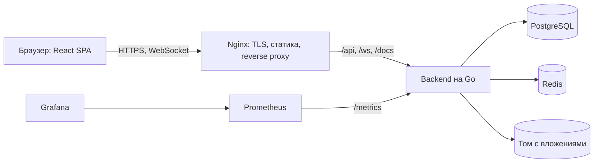
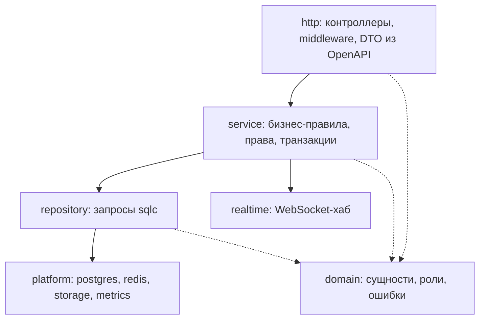
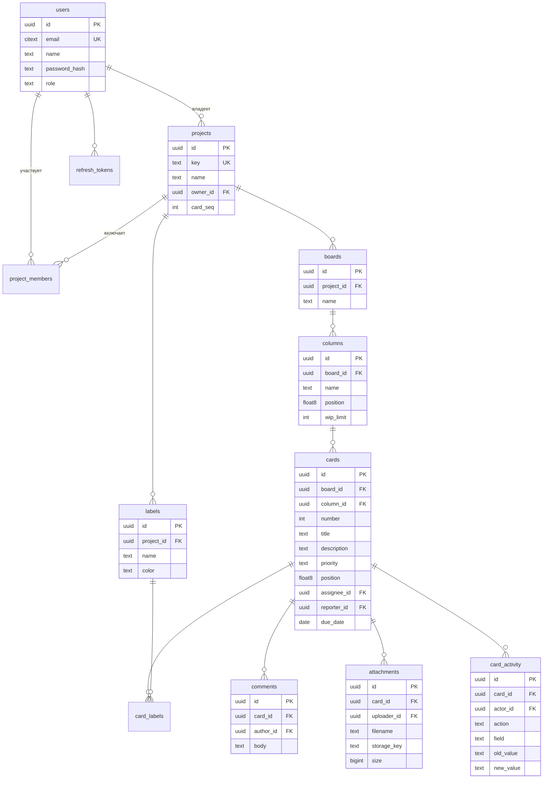

# Архитектура

Приложение — монолит со слоистой архитектурой: одностраничный клиент, один серверный процесс, PostgreSQL и Redis. Монолит выбран, потому что методические указания рекомендуют его для лабораторной работы, а один разворачиваемый сервис проще покрыть интеграционными и E2E-тестами.

## Компоненты

## Слои сервера

Зависимости направлены строго вниз. Контроллер разбирает запрос, вызывает сервис и переводит доменную ошибку в HTTP-ответ. Сервис содержит все правила — права доступа, WIP-лимит, запись истории — и зависит от интерфейсов репозиториев, а не от их реализации; за счёт этого модульные тесты сервисов работают на подставных репозиториях без базы данных. Репозиторий — единственное место, где выполняется SQL.

Код контроллеров и типы запросов генерируются из `api/openapi.yaml` (`oapi-codegen`), типы клиента — из того же файла (`openapi-typescript`). Контракт существует в одном экземпляре, расхождение клиента и сервера обнаруживается на этапе сборки.

## Модель данных

## Ключевые решения

**Порядок карточек и колонок.** Позиция хранится числом с плавающей точкой. Новая позиция при перемещении — середина между соседями, поэтому изменяется одна строка, а не вся колонка. Когда промежуток между соседями становится слишком мал, колонка перенумеровывается в той же транзакции.

**WIP-лимит.** Перемещение и создание карточки выполняются в транзакции, которая сначала блокирует строку целевой колонки (`SELECT ... FOR UPDATE`), затем считает карточки и сравнивает с лимитом. Два одновременных запроса выстраиваются в очередь на блокировке, обойти лимит гонкой нельзя. При превышении сервер отвечает `409 WIP_LIMIT_EXCEEDED`, клиент возвращает карточку на место и показывает предупреждение. Перестановка внутри той же колонки лимитом не ограничивается.

**История действий.** Запись в `card_activity` создаётся сервисом в той же транзакции, что и изменение, поэтому история не расходится с данными.

**Поиск и фильтрация.** Текстовый поиск идёт по триграммному индексу GIN (`pg_trgm`) по названию и описанию, фильтры — по btree-индексам. Выдача постраничная.

**Аутентификация.** Access JWT живёт 15 минут и хранится только в памяти клиента. Refresh-токен — случайная строка в httpOnly-cookie с `SameSite=Strict` и путём `/api/v1/auth`; в PostgreSQL хранится его SHA-256. При каждом обновлении токен заменяется, повторное предъявление использованного токена отзывает всю цепочку. Роль записана в access-токене, поэтому изменение роли вступает в силу при следующем обновлении токена — не позже чем через 15 минут.

**CSRF.** Рабочие запросы несут токен в заголовке `Authorization`, который браузер сам не подставляет. Единственные запросы, авторизованные cookie, — `/auth/refresh` и `/auth/logout`; для них действует double-submit: значение cookie `csrf_token` должно совпасть с заголовком `X-CSRF-Token`.

**Ограничение частоты.** Вход и регистрация ограничены 20 запросами в минуту с адреса (счётчики в Redis). Адрес клиента берётся из `X-Real-IP` только если запрос пришёл от прокси из частной сети; при недоступности Redis ограничение отключается, а не блокирует вход.

**Валидация.** Каждый запрос сверяется с `api/openapi.yaml` (kin-openapi): типы, форматы, длины, обязательные и лишние поля. Сервисы дополнительно проверяют смысл: название из одних пробелов, исполнитель вне проекта, метка чужого проекта.

**Real-time.** Сервер держит WebSocket-соединения, сгруппированные по доске. После успешного изменения сервис публикует событие в канал Redis; хаб каждого экземпляра сервера рассылает его подключённым клиентам. Redis между сервисом и хабом нужен, чтобы схема работала при нескольких экземплярах сервера.

**Вложения.** Файл сохраняется на том под случайным ключом, исходное имя хранится только в базе. Размер и тип проверяются на сервере, скачивание идёт с `Content-Disposition: attachment` и `X-Content-Type-Options: nosniff`.

## Конфигурация и окружения

Все параметры задаются переменными окружения, перечень — в `.env.example`. Окружения: локальное (Docker Compose), тестовое в CI, staging и production на VPS. Схема базы меняется только миграциями goose, которые применяются при деплое до запуска новой версии.

## Наблюдаемость

Сервер отдаёт `/healthz` (процесс жив), `/readyz` (доступны база и Redis) и `/metrics` в формате Prometheus: число запросов, гистограмма длительности по маршрутам, состояние пула соединений, число WebSocket-клиентов. Логи — структурированные, в JSON, с идентификатором запроса.
